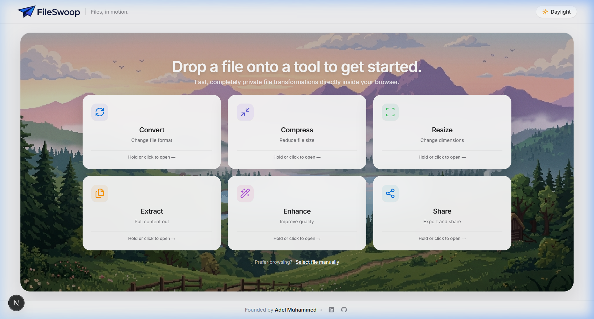
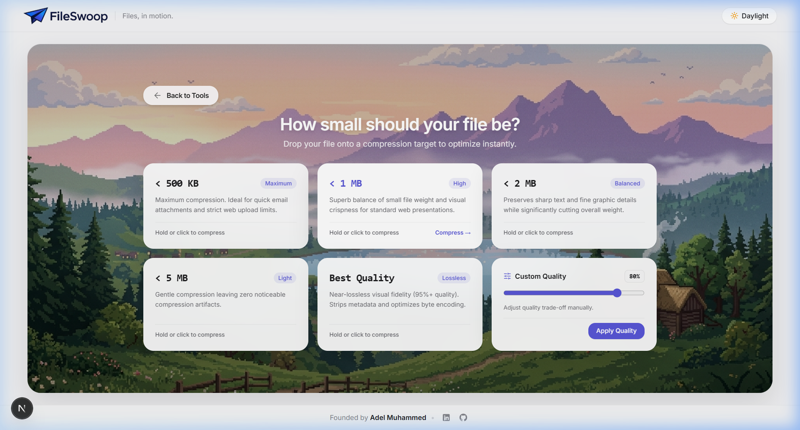
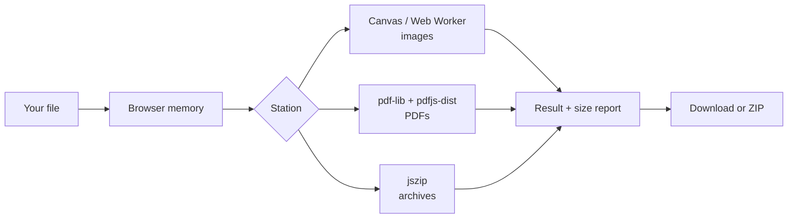

<div align="center">


# FileSwoop
### Files, in motion.

Convert, compress, resize, extract and enhance your files in one flow, in seconds. Right in your browser, with nothing uploaded.

[Live demo](https://fileswoop.vercel.app/) · [Report a bug](https://github.com/dragon486/FileSwoop/issues) · [Request a feature](https://github.com/dragon486/FileSwoop/issues)

<br/>

[](https://github.com/dragon486/FileSwoop/stargazers)
[](https://github.com/dragon486/FileSwoop/network/members)
[](https://nextjs.org/)
[](https://fileswoop.vercel.app/)

<br/><br/>



</div>

---

## One flow. A few seconds.

Other tools make you bounce between pages: convert here, compress there, resize somewhere else, uploading and downloading each time.

FileSwoop does it all in a single flow, in seconds. This is what FileSwoop is built around.

```
Drop a file → Convert to WebP → Compress to under 1 MB → Resize to 1080p → Download (or ZIP)
```

Chain consecutive transformations, see the exact size saved, and download once. No accounts, no uploads, no repeated trips.

---

## And it stays private

Most online converters make you upload your contracts, medical records, bank statements and personal photos to someone else's server, then wait in a queue.

FileSwoop has no server processing your files. Everything runs on your device using Web APIs, HTML5 Canvas and WebAssembly.

| Feature | Typical online converter | FileSwoop |
| :--- | :--- | :--- |
| **Your file is uploaded to a server** | Yes | **No** |
| **Waiting for upload, queue and download** | Yes | **No, it starts instantly** |
| **Works with a poor connection** | No | **Yes, once the page has loaded** |
| **Several steps (convert, compress, resize)** | Separate tools, repeated uploads | **One flow** |

> **Check it yourself:** Open your browser's DevTools, go to the **Network** tab, and transform a file. You will see no file upload.

---

## Features

FileSwoop is organised into six stations.

### Convert
JPG, PNG, WebP, PDF, GIF and TXT. Convert between image and document formats, or pull plain text out of a document.

### Compress

| Preset | Target |
| :--- | :--- |
| **Maximum** | under 500 KB |
| **High** | under 1 MB |
| **Balanced** | under 2 MB |
| **Light** | under 5 MB |
| **Best Quality** | Lossless, strips redundant EXIF and metadata |
| **Custom** | Quality slider from 10% to 95% |

<br/>



<br/>

### Resize
- **Social**: Avatar 500 × 500, Landscape Post 1200 × 630, Story 1080 × 1920
- **Displays**: HD 720p, Full HD 1080p, Ultra HD 4K
- **Custom**: any width and height, with a one-click aspect-ratio lock

### Extract
- Unpack ZIP archives in memory
- Pull plain text out of PDFs
- Split multi-page PDFs into single-page files

### Enhance
Auto Contrast, Sharpen, Grayscale and Vibrant Saturation (+30%), applied with pixel-level Canvas filters.

### Share and Export
- Instant local download
- Bundle results into a single ZIP
- Size-savings report: original size, new size and percentage saved
- Workflow chaining across all stations

---

## Design

- **Daylight and Midnight themes**: frosted glass in light mode, deep obsidian in dark mode
- **Floating file object** showing the file's name, format and size
- **Hold-to-transform dwell timer (2.5 seconds)** that gives you a moment to confirm before an action is applied
- **Circular progress rings** instead of progress bars
- **Physics-based animation** with Framer Motion spring transitions

---

## How it works



*No arrow leaves your device.*

---

## Tech stack

| Layer | Technology |
| :--- | :--- |
| **Framework** | Next.js 16 (App Router, Turbopack) |
| **Styling** | Tailwind CSS and custom CSS |
| **Animation** | Framer Motion |
| **Image compression** | browser-image-compression and Canvas (Web Worker, WebAssembly) |
| **PDF** | pdf-lib and pdfjs-dist |
| **Archives** | jszip |
| **Icons** | lucide-react and a custom origami logo |

---

## Getting started

```bash
git clone https://github.com/dragon486/FileSwoop.git
cd FileSwoop
npm install
npm run dev
```

Open [http://localhost:3000](http://localhost:3000/).

Build for production:

```bash
npm run build
npm start
```

---

## Contributing

Contributions are welcome. Good first areas: new output formats, more resize presets, accessibility improvements and translations.

1. Fork the repo
2. Create a branch: `git checkout -b feature/your-idea`
3. Commit and push
4. Open a pull request

---

## Support the project

If FileSwoop saved you a trip to a sketchy converter site, please give it a star. It helps other people find a private alternative.

⭐ **[Star on GitHub](https://github.com/dragon486/FileSwoop)**

---

## License

Distributed under the [MIT License](LICENSE). See [LICENSE](LICENSE) for more details.

---

<div align="center">

Built by [@dragon486](https://github.com/dragon486)

**FileSwoop. Files, in motion.**

</div>
